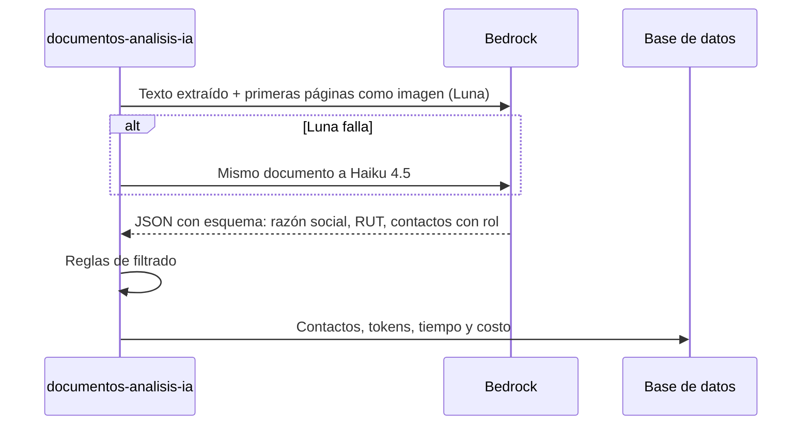

# Atribución de contactos

Caso de uso: decidir si un correo o teléfono es del comprador (deudor) o del proveedor (vendedor), y con cuánta confianza. Relacionado: [flujo de ingesta](ingesta.md), [API de consultas](../api/consultas.md).

## Fuentes de un contacto

| Fuente | Origen | Confianza |
|---|---|---|
| `FICHA_OC` | `__VIEWSTATE` de la ficha de la OC | 0,95 |
| `DOCUMENTO` | Regex sobre el texto de las bases | 0,45 a 0,9 |
| `DOCUMENTO_IA` | Bedrock sobre documentos del proveedor | Según el modelo; baja si el correo no aparece en el texto |

Cada contacto guarda su evidencia (el fragmento o la referencia de origen) para revisarlo a mano.

## Regex sobre las bases

`src/extraccion/contactos.extractor.ts`, de la señal más fuerte a la más débil:

1. Un RUT conocido cerca (el del comprador o el de un oferente): 0,9.
2. El dominio del correo se parece al nombre de una de las partes, o es `.gob.cl` / `.mun.cl`: 0,75.
3. Palabras de contexto cerca ("oferente", "representante legal" → proveedor; "unidad requirente", "contraparte técnica" → comprador): 0,45 a 0,6.

Las bases las escribe el comprador, así que el regex nunca atribuye un contacto de las bases al proveedor.

## Lectura con IA

`src/extraccion/analisis-ia.service.ts`.

- Solo pasan los documentos del proveedor (Anexo N°1, cotización), no las bases.
- El costo se calcula con el precio del modelo que respondió.

### Reglas sobre lo que devuelve el modelo

| Regla | Motivo |
|---|---|
| Más de `bedrock.max_contactos_documento` personas: solo queda el representante legal | Es una lista de referencias o clientes, no de contactos del proveedor |
| Un "comprador" necesita correo institucional | En un documento del proveedor suele ser un nombre mencionado, no un contacto |
| El representante legal del propio oferente se guarda aunque no traiga correo ni teléfono | El nombre ya sirve para la gestión comercial |
| Un representante de otro RUT sin correo ni teléfono se descarta | Certificados de terceros (laboratorio, distribuidor) |

`scripts/reaplicar-analisis.ts` vuelve a aplicar estas reglas a los análisis guardados sin llamar al modelo. `scripts/comparar-modelo.ts` corre otro modelo sobre documentos ya analizados sin escribir en la base.

## Costos medidos (71 documentos, 10-11-2026)

| Modelo | Por documento | Precio por millón de tokens (entrada / salida) |
|---|---|---|
| Luna (`openai.gpt-5.6-luna`) | US$ 0,0014 | 0,22 / 1,32 |
| Haiku 4.5 | US$ 0,0053 | 1 / 5 |

La cifra oficial es la factura de AWS.
