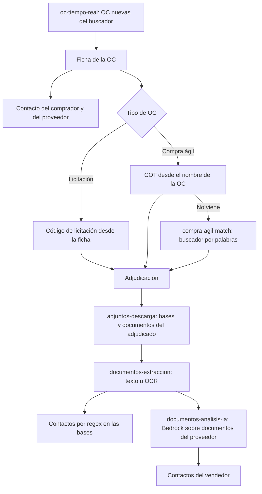

# Flujo de ingesta

Caso de uso: partir de las compras del Estado y terminar con el comprador, el proveedor adjudicado y sus contactos. Relacionado: [fuentes](../fuentes.md), [crons](../jobs/crons.md), [contactos](contactos.md), [modelo de datos](../models/modelo-de-datos.md).

## Actores

| Actor | Rol |
|---|---|
| Crons | Ejecutan cada etapa en su horario |
| Mercado Público | Datos abiertos, buscador, fichas y adjuntos |
| Bedrock | Lee los documentos del proveedor |
| Operador | Dispara, pausa o reconfigura desde el panel o la API |

## Dos entradas

1. **Histórica.** `datos-abiertos-sync` carga los `.zip` mensuales: empresas, procesos, ofertas, OC y adjudicaciones.
2. **Tiempo real.** `oc-tiempo-real` trae las OC nuevas del buscador cada 30 minutos. Solo esta entrada lee fichas y baja adjuntos.

## Secuencia en tiempo real

## Etapas

| Etapa | Cron | Entrada | Salida |
|---|---|---|---|
| OC nuevas | `oc-tiempo-real` | Buscador | `ordenes_compra`, `empresas` |
| Ficha de la OC | `oc-fichas` | OC sin ficha leída | `contactos` (fuente `FICHA_OC`), proceso de origen |
| Cruce con compra ágil | `compra-agil-match` | OC tipo AG sin proceso | `procesos`, `ofertas`, `adjudicaciones` |
| Adjuntos | `adjuntos-descarga` | Procesos con `adjuntos_estado = PENDIENTE` | `documentos` y archivos en disco o S3 |
| Texto y OCR | `documentos-extraccion` | Documentos descargados | Texto y contactos por regex |
| Lectura con IA | `documentos-analisis-ia` | Documentos del proveedor | `contactos` (fuente `DOCUMENTO_IA`) |

## Reintentos y cortes

- Cada etapa trabaja por lotes sobre lo pendiente, así que una caída se retoma sola en la corrida siguiente.
- Los intentos tienen tope (`adjuntos.max_intentos`, `match_compra_agil.max_intentos`); pasado el tope el registro queda en `ERROR`.
- Un 403 del portal de licitaciones corta la corrida de adjuntos para no agravar el bloqueo.
- Un adjunto que pesa más que `adjuntos.max_mb_por_archivo` no se baja y queda como `OMITIDO`.
- Un documento con error de IA queda en `ERROR` y se reprocesa con `POST /documentos/:id/analizar-ia`.

## Acciones manuales equivalentes

Cada etapa tiene un endpoint para ejecutarla sobre un código puntual: ver [API de tiempo real](../api/tiempo-real.md) y [API de documentos](../api/documentos.md).
