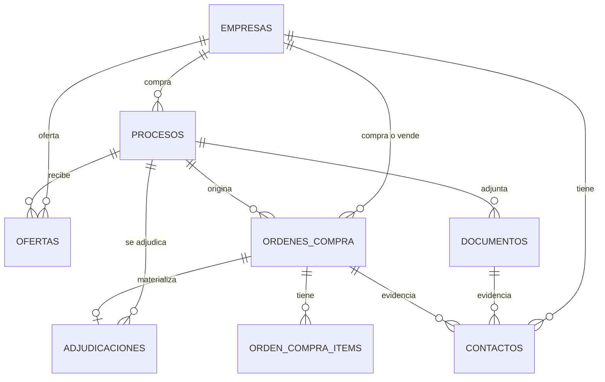

# Modelo de datos

Postgres, definido en `prisma/schema.prisma`. Las migraciones corren al arrancar la app. Relacionado: [flujo de ingesta](../flows/ingesta.md), [API de consultas](../api/consultas.md).

## Tablas de negocio

| Tabla | Clave | Qué guarda |
|---|---|---|
| `empresas` | `rut` (normalizado, `76123456-7`) | Cada RUT visto, con `es_organismo` y `es_proveedor` |
| `procesos` | `codigo` | Licitaciones y compras ágiles: tipo, estado, comprador, fechas, monto y estado de sus adjuntos |
| `ofertas` | `id` (UUID) | Ítem × proveedor: monto ofertado, adjudicado, `seleccionada`; `id_externo` es el id de la cotización en compra ágil |
| `ordenes_compra` | `id` (el ID numérico de Mercado Público) | OC con comprador, proveedor, monto, fuente y `proceso_codigo` |
| `orden_compra_items` | `id` | Líneas de cada OC |
| `adjudicaciones` | `id` (UUID) | Quién se adjudicó cada proceso, la OC que lo materializa y el origen del dato |
| `documentos` | `id` (UUID) | Adjuntos: origen (`BASES`, `OFERTA`, `COTIZACION`), proveedor dueño, hash, ruta, texto, método (`TEXTO`, `OCR`) y análisis de IA con tokens y costo |
| `contactos` | `id` (UUID); `clave` única | Correo o teléfono con rol, RUT, fuente, evidencia, confianza y veces visto |
| `v_adjudicaciones` | Vista | Adjudicación con el enlace al proceso, comprador, proveedor y OC |

## Tablas de operación

| Tabla | Qué guarda |
|---|---|
| `archivos_masivos` | Estado de cada mes de datos abiertos: ETag, tamaño, filas, errores |
| `configuraciones` | Parámetros modificados y marcas de agua internas de los crons (`marca.*`) |
| `cron_job_configs` | Pausa y horario propio de cada cron |
| `cron_job_runs` | Historial de ejecuciones |
| `cron_turnos` | Turno que evita ejecuciones dobles entre instancias |

## Reglas de los datos

- **Rol del contacto.** `COMPRADOR` es el organismo (deudor de la factura); `PROVEEDOR` es el adjudicado (vendedor).
- **Clave del contacto.** `rut|rol|correo`; si no hay correo, `rut|rol|tel:teléfono`; si solo hay nombre, `rut|rol|nombre:nombre`. Volver a ver el mismo contacto suma `veces_visto` en vez de duplicarlo.
- **Ruta del adjunto.** `s3://bucket/clave` o `local://clave` relativa a `STORAGE_DIR`.
- **IDs grandes.** Los ID de OC e ítems son `BIGINT` y se serializan como texto en la API.

## Volumen (2026, enero a noviembre)

| Tabla | Filas | Tamaño |
|---|---|---|
| `orden_compra_items` | 4,26 millones | 1,5 GB |
| `ordenes_compra` | 1,5 millones | 1,5 GB |
| `ofertas` | 1,38 millones | 490 MB |
| `adjudicaciones` | 1,16 millones | 360 MB |
| `procesos` | 590 mil | 200 MB |
